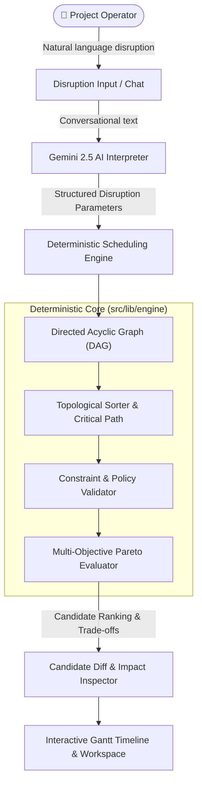

# PlanPatch — Adaptive Project Schedule & Recovery Engine

> **"Plans change. Know what to change next."**  
> When a task fails, a resource disappears, or a deadline moves, PlanPatch finds alternative recovery paths while preserving the work that still matters.

[](https://grevix-plan-patcher.vercel.app/)
[](https://github.com/Kartikey-97/Grevix_PlanPatcher)
[](https://nextjs.org/)
[](https://www.typescriptlang.org/)

---

## 🌟 Executive Summary

When projects run into disruptions—such as sudden vendor cancellations, severe budget cuts, or compressed deadlines—traditional project management tools either require hours of manual graph edits or suggest unfeasible, brittle fixes.

**PlanPatch** solves this through a hybrid intelligence model:
1. **Google Gemini LLM** parses conversational natural-language disruptions and user intent into strictly typed parameters with transparent provenance tracking.
2. A **Deterministic DAG Scheduling Engine** calculates topological sort orders, early/late start intervals, critical paths, and total project slack without LLM hallucinations.
3. A **Multi-Objective Pareto Frontier Solver** evaluates alternative candidate schedules across competing dimensions (cost delta, slack preservation, and scope retention) to present optimal, verified recovery options.

---

## 🚀 Live Demo & Links

- **Live Production URL:** [https://grevix-plan-patcher.vercel.app/](https://grevix-plan-patcher.vercel.app/)
- **GitHub Repository:** [https://github.com/Kartikey-97/Grevix_PlanPatcher](https://github.com/Kartikey-97/Grevix_PlanPatcher)
- **Challenge Card 2 Feedback Proof:** Located under the [`/feedback`](./feedback) directory.

---

## 🏗️ System Architecture



### 1. Natural-Language Disruption Interpreter (`src/lib/ai/`)
- Powered by Google Gemini with graceful fallback generation.
- Extracts structured disruption events:
  - `task_failure` (e.g. equipment malfunction)
  - `resource_unavailable` (e.g. auditorium double-booked)
  - `budget_cut` (e.g. ₹5,000 budget reduction)
  - `deadline_tightened` (e.g. festival moved up by 48 hours)
- Maintains strict provenance tagging (`user_provided`, `ai_estimate`, `derived`, `missing`) so estimates are never mistaken for ground truth.

### 2. Deterministic Scheduling & Graph Engine (`src/lib/engine/`)
- **Topological Sorting:** Computes clean dependency waterfalls and validates acyclicity ($O(V + E)$).
- **Critical Path Calculation:** Calculates earliest start (`ES`), earliest finish (`EF`), latest start (`LS`), latest finish (`LF`), and float/slack hours per task.
- **Policy Enforcement:** Honors task constraints (`fixed` requirements cannot be dropped; `flexible` can adjust durations/costs; `optional` can be omitted under extreme budget strain).

### 3. Pareto Frontier Multi-Objective Ranking (`src/lib/engine/rank-candidates.ts`)
Evaluates candidate plans across non-dominated trade-off vectors:
- **Cost Minimization:** Total budget compliance and cost delta against baseline.
- **Slack Preservation:** Margin between projected completion and hard project deadline.
- **Scope Retention:** Proportion of original requirements and tasks preserved intact.
- **Operator Trade-off Profiles:** Balanced, Budget-Priority, Time-Critical, and Maximum Scope.

---

## 🎨 Key Features & UI Experience

### 1. Editorial Landing Page & Adaptive Recovery Simulator
- **Editorial Typography & Hero:** Minimalist, art-directed dark aesthetic inspired by modern technology portfolios.
- **Live Interactive Simulator:** A compact, interactive before-and-after demonstration explaining how PlanPatch isolates unavailable resources, reroutes dependencies, and recalculates finish times in seconds.
- **Seamless Theme Switcher:** Fully synchronized Dark and Light mode support across both the landing experience and workspace.

### 2. Interactive Schedule Timeline (`PlanTimeline.tsx`)
- **Dynamic Horizon Modes:**
  - **Fit Work (`152h`):** Zooms directly into active project tasks with 15% breathing room, doubling bar clarity.
  - **Project Deadline (`288h`):** Reveals global schedule buffer and deadline slack.
- **No Truncation:** 260px wide task identifier sidebar and non-wrapping duration labels (`8h`, `16h`) ensure zero clipping.
- **Dependency Inspection:** Click any task to highlight upstream predecessors, downstream successors, slack margin, and critical path status.

### 3. Custom Plan Builder (`CustomPlanBuilder.tsx`)
- **AI-Guided Generation:** Describe any project goal in ordinary words; Gemini drafts tasks, durations, costs, and dependencies.
- **Software Engineering Template:** Pre-configured 6-stage development lifecycle with ₹95,000 budget and realistic dependencies.
- **Full Manual Matrix Editor:** Step-by-step custom task creation, predecessor mapping, and JSON import/export.

### 4. Atomic Diff & Impact Inspector (`DiffViewer.tsx`)
- Side-by-side comparison between disrupted baseline and candidate solutions.
- Visual status indicators for modified, substituted, removed, and preserved tasks.
- In-memory local preview allowing operators to test patches safely before commitment.

---

## 🛠️ Tech Stack

- **Framework:** Next.js 15.5 (App Router, Turbopack ready)
- **Language:** TypeScript 5.0 (Strict mode enabled)
- **Styling:** Tailwind CSS with custom editorial color palettes
- **Icons:** Lucide React
- **AI:** Google Gemini API (`@google/genai`)
- **Testing:** Vitest with React Testing Library (352 unit tests)
- **Deployment:** Vercel

---

## 📋 Challenge Card 2: Real-World Feedback Mission

As part of the **GREVIX Challenge Card 2** mission:
> *"Share your project demo, collect genuine feedback, implement improvements, and upload proof under a `/feedback` folder or README."*

### Summary of Peer Feedback
- **Reviewer:** Kshiraj K (Peer Developer & Community Tester)
- **Feedback Proof:** Stored under the [`/feedback`](./feedback) directory ([`feedback(grevix).jpeg`](./feedback/feedback(grevix).jpeg)).
- **Key Issues Identified:**
  1. **Dark Mode Component Inconsistencies:** Certain workspace panels retained white backgrounds, creating jarring light cards inside dark mode.
  2. **Timeline Chart Formatting:** The demo chart squished active tasks across an oversized horizon and clipped task labels and duration numbers.

### Actions Taken & Improvements
- **Universal Dark/Light Theming:** Overhauled `DiffViewer.tsx`, `CustomPlanBuilder.tsx`, `PlanOverview.tsx`, `DisruptionInput.tsx`, and `RecoveryComparison.tsx` with dedicated theme hooks and dark styling tokens (`#0d1322`, `#131b2e`, `#1e293b`).
- **Timeline Engine Overhaul (`PlanTimeline.tsx`):** Added a "Fit Work" vs "Project Deadline" horizon toggle, expanded sidebar width to 260px, enlarged duration badges, and sorted tasks along the topological critical path.
- **Full Feedback Documentation:** Detailed analysis, exact quotes, and resolution steps are recorded in [`feedback/FEEDBACK_LOG.md`](./feedback/FEEDBACK_LOG.md).

---

## 💻 Local Development Setup

### Prerequisites
- Node.js 18.x or 20.x
- npm or pnpm

### 1. Clone the repository
```bash
git clone https://github.com/Kartikey-97/Grevix_PlanPatcher.git
cd Grevix_PlanPatcher
```

### 2. Install dependencies
```bash
npm install
```

### 3. Environment Variables (Optional)
To enable live Gemini AI disruption interpretation and draft planning:
```bash
cp .env.example .env.local
# Add your Google Gemini API key:
# GEMINI_API_KEY="your-api-key-here"
```
*(Note: PlanPatch includes built-in offline heuristic fallbacks for disruption parsing and draft generation if no API key is provided).*

### 4. Run Development Server
```bash
npm run dev
```
Open [http://localhost:3000](http://localhost:3000) to view the application.

### 5. Run Test Suite
```bash
npm test
```
Runs all **352 unit tests** covering graph topology, constraint validation, candidate generation, Pareto frontier ranking, and UI workflows.

### 6. Production Build
```bash
npm run build
npm run start
```

---

## 📜 License

MIT License. Designed and built for the **GREVIX** challenge.
